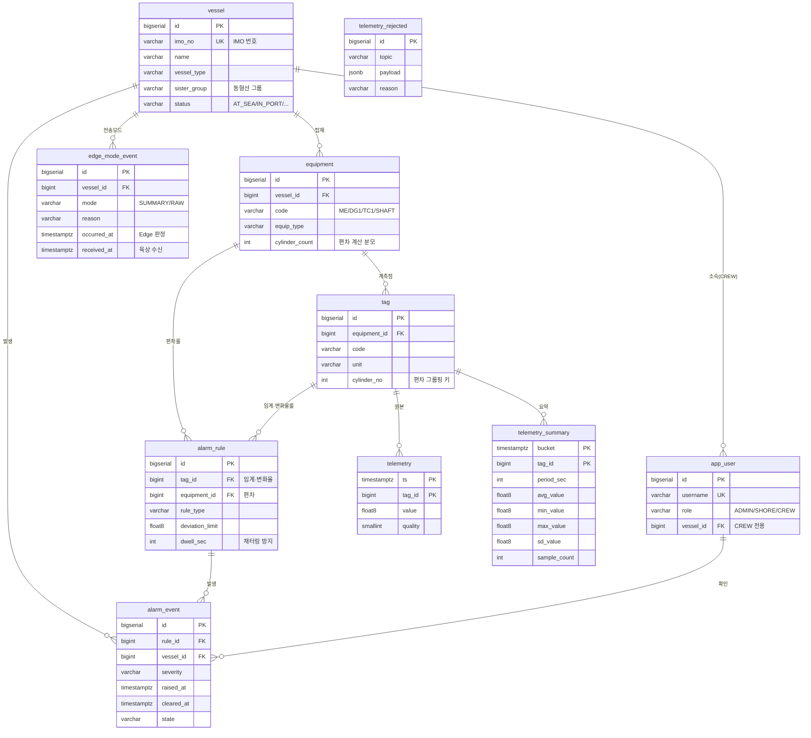

# VesselOps 데이터베이스 설계서

| 항목 | 내용 |
|---|---|
| 문서명 | 선박 기관 원격 상태감시 플랫폼 데이터베이스 설계서 |
| 버전 | v1.1 |
| 작성일 | 2026-10-10 |
| 작성자 | 최승렬 |
| 선행문서 | `01-requirements.md` (v1.3), `02-architecture.md` (v1.2), `03-interface-spec.md` (v1.2) |
| 관련문서 | `00-glossary.md` (용어 정의), `06-function-spec.md` (이 스키마를 쓰는 프로그램의 처리 절차) |
| DBMS | PostgreSQL 16 + TimescaleDB 2.17 (커뮤니티) |
| 스키마 파일 | `db/init/01-schema.sql`, `db/init/02-seed.sql` |

---

## 목차

1. [설계 원칙](#1-설계-원칙)
2. [ERD](#2-erd)
3. [테이블 정의서](#3-테이블-정의서)
4. [시계열 설계](#4-시계열-설계)
5. [조회 전략 — 원본·요약 병합](#5-조회-전략--원본요약-병합)
6. [인덱스 설계](#6-인덱스-설계)
7. [제약조건의 의도](#7-제약조건의-의도)
8. [용량 산정](#8-용량-산정)
9. [데이터 생명주기](#9-데이터-생명주기)
10. [백업·복구](#10-백업복구)
11. [변경 이력](#11-변경-이력)

---

## 1. 설계 원칙

| 원칙 | 내용 |
|---|---|
| **시계열과 마스터를 한 DB 에 둔다** | "STELLA 선급의 3번 실린더 배기온도" 같은 질의가 마스터와 시계열의 조인이다. DB 를 나누면 이 조인을 애플리케이션이 수동으로 해야 한다 (ADR-002) |
| **무결성은 DB 가 보장한다** | 중복 제거, 역할별 필수값, 룰 종류별 파라미터를 애플리케이션이 아닌 제약조건으로 강제한다. 유입 경로가 여러 개이기 때문이다 |
| **품질이 나쁜 값도 저장한다** | 센서 고장 자체가 진단 대상이다. 다만 알람 판정에서는 제외한다 |
| **식별자는 내부 시퀀스, 업무키는 별도** | `vessel.id`(BIGSERIAL)와 `imo_no`(업무 고유키)를 분리한다. IMO 번호는 국제 고유키지만 문자열이라 조인 비용이 크다 |
| **시각은 전부 `TIMESTAMPTZ`** | 선박은 항해 중 현지시각을 변경한다. UTC 기준으로 저장하지 않으면 시계열이 역전된다 |

---

## 2. ERD



---

## 3. 테이블 정의서

### 3.1 `vessel` — 선박 마스터

| 컬럼 | 타입 | NULL | 기본값 | 설명 |
|---|---|---|---|---|
| `id` | BIGSERIAL | N | — | PK |
| `imo_no` | VARCHAR(10) | N | — | **UNIQUE**. IMO 선박식별번호 |
| `name` | VARCHAR(100) | N | — | 선명 |
| `vessel_type` | VARCHAR(30) | N | — | CONTAINER / BULK_CARRIER / LNG_CARRIER / TANKER / PCTC |
| `class_society` | VARCHAR(10) | Y | — | KR / DNV / LR / ABS / NK |
| `flag_state` | VARCHAR(40) | Y | — | 선적국 |
| `built_year` | INT | Y | — | 건조년도 |
| `dwt` | INT | Y | — | 재화중량톤수 |
| `sister_group` | VARCHAR(40) | Y | — | 동형선 그룹. 성능 비교 기준 (FR-204) |
| `status` | VARCHAR(15) | N | `AT_SEA` | AT_SEA / IN_PORT / ANCHORED / DRYDOCK |
| `created_at` / `updated_at` | TIMESTAMPTZ | N | `now()` | `updated_at` 은 트리거로 자동 갱신 |

### 3.2 `app_user` — 사용자

| 컬럼 | 타입 | NULL | 설명 |
|---|---|---|---|
| `id` | BIGSERIAL | N | PK |
| `username` | VARCHAR(50) | N | **UNIQUE** |
| `password_hash` | VARCHAR(100) | N | BCrypt 해시. **평문 저장 금지** |
| `display_name` | VARCHAR(80) | N | 표시 이름 |
| `email` | VARCHAR(120) | Y | — |
| `role` | VARCHAR(10) | N | ADMIN / SHORE / CREW |
| `vessel_id` | BIGINT | Y | **CREW 전용** 소속 선박 (FR-503) |
| `enabled` | BOOLEAN | N | 계정 활성 여부 |
| `last_login_at` | TIMESTAMPTZ | Y | — |

> 계정은 시드 SQL 에 넣지 않고 **Spring Boot 기동 시 `BCryptPasswordEncoder` 로 생성**한다.
> SQL 에 해시를 박으면 어떤 평문인지 알 수 없고 운영 환경까지 그대로 따라간다.
>
> 현재 버전은 인증(FR-501~503)을 구현하지 않아 이 테이블은 비어 있다. `alarm_event.ack_by` 도 NULL 로 남는다.

### 3.3 `equipment` — 기관·장비

| 컬럼 | 타입 | NULL | 설명 |
|---|---|---|---|
| `id` | BIGSERIAL | N | PK |
| `vessel_id` | BIGINT | N | FK → `vessel`. ON DELETE CASCADE |
| `code` | VARCHAR(20) | N | ME / DG1 / DG2 / TC1 / SHAFT. `(vessel_id, code)` **UNIQUE** |
| `name` | VARCHAR(100) | N | 장비명 |
| `equip_type` | VARCHAR(20) | N | MAIN_ENGINE / GEN_ENGINE / TURBOCHARGER / SHAFTING / BOILER |
| `maker` / `model` | VARCHAR(60) | Y | 예: Hanwha Engine / 7S60ME-C10.5 |
| `rated_power_kw` | NUMERIC(10,2) | Y | 정격출력 |
| `rated_rpm` | NUMERIC(8,2) | Y | 정격회전수 |
| `cylinder_count` | INT | Y | **실린더 수 — 편차 계산의 분모** |
| `running_hours` | NUMERIC(10,1) | Y | 누적 운전시간 |
| `installed_on` | DATE | Y | 설치일 |

### 3.4 `tag` — 계측점

| 컬럼 | 타입 | NULL | 설명 |
|---|---|---|---|
| `id` | BIGSERIAL | N | PK |
| `equipment_id` | BIGINT | N | FK → `equipment`. `(equipment_id, code)` **UNIQUE** |
| `code` | VARCHAR(60) | N | 예: `ME_EXH_T_CYL04` |
| `name` | VARCHAR(120) | N | 표시명 |
| `unit` | VARCHAR(20) | Y | degC / bar / rpm / kW / kg/h / mm/s |
| `data_type` | VARCHAR(10) | N | 기본 FLOAT |
| **`cylinder_no`** | INT | Y | **실린더별 태그면 번호, 공통 태그면 NULL** |
| `normal_min` / `normal_max` | FLOAT8 | Y | 정상 범위 |
| `scan_ms` | INT | N | 수집 주기 |
| `enabled` | BOOLEAN | N | 사용 여부 |

> **`cylinder_no` 를 컬럼으로 둔 이유.** 편차 알람(FR-302)은 "같은 기관의 실린더 태그"를 묶어
> 평균을 내야 한다. 태그명 문자열을 파싱(`ME_EXH_T_CYL04` → 4)하면 명명규칙이 바뀌는 순간 깨지고,
> AMS 제조사마다 명명이 다르므로 실선 적용 시 반드시 깨진다. **그룹핑 키를 데이터로 갖는다.**

### 3.5 `telemetry` — 계측 원본 (Hypertable)

| 컬럼 | 타입 | NULL | 설명 |
|---|---|---|---|
| `ts` | TIMESTAMPTZ | N | **계측 시각**(발행 시각 아님). 파티셔닝 키 |
| `tag_id` | BIGINT | N | FK → `tag` |
| `value` | FLOAT8 | Y | 계측값 |
| `quality` | SMALLINT | N | 192(Good) / 64(Uncertain) / 0(Bad) |

`(tag_id, ts)` **UNIQUE** — 재전송 중복 차단 (FR-156).

### 3.6 `telemetry_summary` — 계측 요약 (Hypertable)

Edge 가 요약 모드로 전송한 1분 통계를 담는다.

| 컬럼 | 타입 | NULL | 설명 |
|---|---|---|---|
| `bucket` | TIMESTAMPTZ | N | 집계 구간 **시작 시각**. 파티셔닝 키 |
| `tag_id` | BIGINT | N | FK → `tag` |
| `period_sec` | INT | N | 집계 구간(초). 기본 60 |
| `avg_value` | FLOAT8 | Y | 구간 평균 |
| `min_value` / `max_value` | FLOAT8 | Y | 구간 최소·최대 |
| `sd_value` | FLOAT8 | Y | 표준편차 |
| `sample_count` | INT | N | 표본 수 (결측 판단) |
| `quality` | SMALLINT | N | 구간 내 **최악 품질코드** |

`(tag_id, bucket)` **UNIQUE**.

> **왜 TimescaleDB 연속집계(`telemetry_1m`)로 못 쓰는가.**
> 연속집계는 `telemetry` 원본을 재료로 DB 가 자동 생성하는 **읽기 전용 뷰**다.
> 요약 모드에서는 원본이 육상에 오지 않으므로 재료 자체가 없다. 별도 테이블이 필요하다.
> 두 가지는 공존한다 — 원본이 있는 구간은 `telemetry_1m`(자동 생성), 없는 구간은 `telemetry_summary`(Edge 전송).

### 3.7 `edge_mode_event` — 전송 모드 전환 이력

| 컬럼 | 타입 | NULL | 설명 |
|---|---|---|---|
| `id` | BIGSERIAL | N | PK |
| `vessel_id` | BIGINT | N | FK → `vessel` |
| `mode` | VARCHAR(10) | N | SUMMARY / RAW |
| `reason` | VARCHAR(40) | Y | THRESHOLD_NEAR / DEVIATION / RATE / QUALITY / MANUAL / RECOVERED |
| `trigger_tag_id` | BIGINT | Y | 전환을 유발한 태그 |
| **`occurred_at`** | TIMESTAMPTZ | N | **Edge 가 판정한 시각** |
| **`received_at`** | TIMESTAMPTZ | N | **육상이 수신한 시각** |

> **이 테이블이 NFR-08·NFR-11 의 측정 근거다.**
> `occurred_at` 과 첫 RAW 데이터의 `ingest` 적재 시각 차이가 NFR-08(15초),
> 트리거 조건 충족 시각과 `occurred_at` 차이가 NFR-11(5초)이다.
> 측정할 수 없는 지표는 요구사항이 아니라 희망사항이므로, 지표를 만들면 기록 테이블도 만든다.

### 3.8 `alarm_rule` — 알람 룰

| 컬럼 | 타입 | NULL | 설명 |
|---|---|---|---|
| `id` | BIGSERIAL | N | PK |
| `tag_id` | BIGINT | Y | 임계값·변화율 룰의 대상 |
| `equipment_id` | BIGINT | Y | **편차 룰의 대상** (기관 단위) |
| `rule_type` | VARCHAR(20) | N | THRESHOLD / DEVIATION / RATE_OF_CHANGE |
| `severity` | VARCHAR(10) | N | HIHI / HI / LO / LOLO / WARN |
| `limit_value` | FLOAT8 | Y | THRESHOLD 용 |
| `deviation_limit` | FLOAT8 | Y | DEVIATION 용 — 평균 대비 허용 편차 |
| `rate_limit` / `rate_window_sec` | FLOAT8 / INT | Y | RATE_OF_CHANGE 용. **`rate_limit` 의 부호가 감시 방향**이다 — 양수는 상승, 음수는 하강 |
| `dwell_sec` | INT | N | **채터링 방지** — 이 시간 이상 지속돼야 확정 (FR-304) |
| `message_template` | TEXT | Y | `{cylinder}`, `{deviation}`, `{value}` 치환 |
| `enabled` | BOOLEAN | N | 사용 여부 |

> **변화율 룰에 방향이 필요한 이유.** 추력베어링 온도는 오르는 것이, 윤활유 압력은 떨어지는 것이 위험하다.
> 절댓값으로만 보면 고장이 해소돼 값이 정상으로 돌아오는 순간에도 "급변" 알람이 발생한다.
> 방향 컬럼을 따로 두지 않고 기준값의 부호로 표현했다 (윤활유 압력 룰은 `-0.5`).

시드 기준 룰은 52건이다 — 편차 8건(4척 × HI·HIHI), 임계값 36건(4척 × 9종), 변화율 8건(4척 × 2종).

### 3.9 `alarm_event` — 알람 이력

| 컬럼 | 타입 | NULL | 설명 |
|---|---|---|---|
| `id` | BIGSERIAL | N | PK |
| `rule_id` | BIGINT | Y | FK → `alarm_rule`. ON DELETE SET NULL |
| `vessel_id` | BIGINT | N | FK → `vessel`. 조회 성능을 위한 **의도적 비정규화** |
| `equipment_id` / `tag_id` | BIGINT | Y | 발생 대상 |
| `severity` | VARCHAR(10) | N | 등급 |
| `message` | TEXT | N | 치환 완료된 메시지 |
| `trigger_value` | FLOAT8 | Y | 발생 시점 계측값 |
| `raised_at` / `cleared_at` | TIMESTAMPTZ | N / Y | 발생·해제 시각 |
| `ack_by` / `ack_at` | BIGINT / TIMESTAMPTZ | Y | 확인자·확인시각 |
| `state` | VARCHAR(10) | N | ACTIVE / ACKED / CLEARED |

> `vessel_id` 는 `tag → equipment → vessel` 로 유도 가능하지만 컬럼으로 둔다.
> 알람 목록은 **선박 기준 조회가 대부분**이고, 3단 조인을 매번 하면 목록 화면이 느려진다.

### 3.10 `telemetry_rejected` — 불량 데이터 격리

| 컬럼 | 타입 | 설명 |
|---|---|---|
| `id` | BIGSERIAL | PK |
| `received_at` | TIMESTAMPTZ | 수신 시각 |
| `topic` | VARCHAR(200) | MQTT 토픽 |
| `payload` | JSONB | 원본 페이로드 |
| `reason` | VARCHAR(200) | SCHEMA_INVALID / UNKNOWN_TAG / TS_OUT_OF_RANGE / VALUE_NOT_FINITE |

> 검증 실패분을 버리면 본선 Edge 의 설정 오류를 추적할 수 없다. 원본 그대로 보관한다.

---

## 4. 시계열 설계

### 4.1 Hypertable

| 테이블 | 파티셔닝 컬럼 | 청크 간격 | 근거 |
|---|---|---|---|
| `telemetry` | `ts` | 1일 | 조회가 대부분 최근 24시간. 청크 단위 삭제로 보존정책이 빠르다 |
| `telemetry_summary` | `bucket` | 7일 | 건수가 원본의 1/60 이라 청크를 크게 잡는다 |

### 4.2 압축

```sql
ALTER TABLE telemetry SET (
    timescaledb.compress,
    timescaledb.compress_segmentby = 'tag_id',
    timescaledb.compress_orderby   = 'ts DESC'
);
SELECT add_compression_policy('telemetry', INTERVAL '7 days');
```

`tag_id` 로 묶으면 같은 태그의 값이 물리적으로 인접해 압축률이 높아지고,
태그 단위 조회 시 읽을 블록 수가 줄어든다.

### 4.3 연속 집계

| 뷰 | 집계 간격 | 갱신 주기 | 보존 |
|---|---|---|---|
| `telemetry_1m` | 1분 | 1분 | 1년 |
| `telemetry_1h` | 1시간 | 10분 | 5년 |

각각 `avg` / `min` / `max` / `count` 를 보관한다. **원본이 존재하는 구간에서만 생성된다.**

---

## 5. 조회 전략 — 원본·요약 병합

적응형 전송의 결과로 **구간마다 보유 데이터의 종류가 다르다.**

```
시간축 ──────────────────────────────────────────────────>
        [요약만]        [원본+요약]         [요약만]
        정상 운전     이상 발생 구간        정상 복귀
        1분 1건        1초 1건             1분 1건
```

### 5.1 병합 규칙

| 조회 구간 | 사용 소스 | 우선순위 |
|---|---|---|
| 원본이 있는 구간 | `telemetry` (또는 `telemetry_1m`) | 1순위 |
| 원본이 없는 구간 | `telemetry_summary` | 2순위 |

```sql
-- 트렌드 조회 (개념)
SELECT bucket, avg_value, min_value, max_value, 'raw' AS src
  FROM telemetry_1m
 WHERE tag_id = $1 AND bucket BETWEEN $2 AND $3
UNION ALL
SELECT s.bucket, s.avg_value, s.min_value, s.max_value, 'summary'
  FROM telemetry_summary s
 WHERE s.tag_id = $1 AND s.bucket BETWEEN $2 AND $3
   AND NOT EXISTS (SELECT 1 FROM telemetry_1m m
                    WHERE m.tag_id = s.tag_id AND m.bucket = s.bucket)
 ORDER BY 1;
```

> **차트에 데이터 출처를 표시한다.** 원본 구간과 요약 구간을 시각적으로 구분하지 않으면
> 사용자가 "왜 여기만 촘촘한가"를 오해한다. 요약 구간은 min~max 를 띠(band)로 함께 그린다.

### 5.2 운영 프로파일

동일 코드로 두 가지 프로파일을 지원한다.

| 프로파일 | `ADAPTIVE_ENABLED` | 동작 | 용도 |
|---|---|---|---|
| **실선 프로파일** | `true` | 평상시 요약, 이상 시 원본 | 실제 선박. 통신비 절감이 목적 |
| **시연 프로파일** | `false` (기본) | 항상 원본 1초 | **데모 사이트.** 화면이 1초마다 갱신되어야 함 |

> **왜 시연 환경은 적응형을 끄는가.** 데모는 클라우드 내부 통신이라 대역 제약이 없는데,
> 적응형을 켜면 화면이 1분마다 갱신되어 NFR-02(1초 이내 반영)와 충돌하고 데모가 밋밋해진다.
> 기능은 구현하되 기본값은 상황에 맞게 둔다. 전환은 Edge 수집기의 환경변수로 하며,
> 실선 프로파일의 동작은 `08-test.md` 에서 검증했다.

### 5.3 현재 구현 범위

| 조회 | 원본·요약 병합 | 비고 |
|---|---|---|
| **최신값** (알람 판정, 화면 현재값) | ✅ 구현 | 계측점마다 `telemetry` 와 `telemetry_summary` 중 더 최근 것을 쓴다. 요약만 들어오는 구간에서도 알람 엔진과 화면이 값을 받도록 하기 위함이다 (이 상태에서의 알람 발생 시험은 미수행, `08-test.md` 10장) |
| **추세** | 차기 | 현재는 `telemetry` 원본만 `time_bucket` 으로 집계한다. 요약 구간은 추세 차트에 나타나지 않는다 |

최신값 조회는 `LEFT JOIN LATERAL` 로 계측점마다 인덱스를 한 번씩 탄다.

```sql
SELECT t.id, l.ts, l.value, l.quality
  FROM tag t
  LEFT JOIN LATERAL (
        SELECT u.ts, u.value, u.quality
          FROM (
                (SELECT m.ts, m.value, m.quality FROM telemetry m
                  WHERE m.tag_id = t.id AND m.ts > now() - INTERVAL '10 minutes'
                  ORDER BY m.ts DESC LIMIT 1)
                UNION ALL
                (SELECT s.bucket + make_interval(secs => s.period_sec), s.avg_value, s.quality
                   FROM telemetry_summary s
                  WHERE s.tag_id = t.id AND s.bucket > now() - INTERVAL '10 minutes'
                  ORDER BY s.bucket DESC LIMIT 1)
               ) u
         ORDER BY u.ts DESC LIMIT 1
       ) l ON TRUE;
```

> 요약의 시각은 구간 **시작**이 아니라 **끝**(`bucket + period_sec`)으로 본다.
> 구간 시작 시각으로 비교하면 1분 요약이 항상 1분 전 값으로 취급돼, 방금 끝난 원본 구간보다 뒤로 밀린다.

---

## 6. 인덱스 설계

| 인덱스 | 대상 | 목적 |
|---|---|---|
| `uq_telemetry` | `telemetry(tag_id, ts DESC)` UNIQUE | **중복 차단(FR-156)** + 태그별 최신값 조회 |
| `uq_telemetry_summary` | `telemetry_summary(tag_id, bucket DESC)` UNIQUE | 중복 차단 + 구간 조회 |
| `idx_tag_cylinder` | `tag(equipment_id, cylinder_no) WHERE cylinder_no IS NOT NULL` | **편차 알람의 실린더 그룹 조회.** 부분 인덱스라 공통 태그를 싣지 않는다 |
| `idx_alarm_vessel` | `alarm_event(vessel_id, raised_at DESC)` | 선박별 알람 목록 |
| `idx_alarm_active` | `alarm_event(state, raised_at DESC) WHERE state <> 'CLEARED'` | 활성 알람 조회. 해제분을 제외해 인덱스가 작다 |
| `uq_alarm_open` | `alarm_event(rule_id) WHERE state <> 'CLEARED'` UNIQUE | **동일 룰의 중복 알람 차단** — 해제 전 재발생 방지 |
| `idx_vessel_sister` | `vessel(sister_group) WHERE NOT NULL` | 동형선 비교 |
| `idx_rule_tag` / `idx_rule_equip` | `alarm_rule(...) WHERE enabled` | 룰 엔진의 활성 룰 조회 |

> 부분 인덱스(`WHERE ...`)를 적극 사용했다. 알람은 해제된 것이 대부분인데,
> 활성 알람만 인덱싱하면 크기가 수십 분의 일로 줄고 조회도 빨라진다.

---

## 7. 제약조건의 의도

| 제약 | 내용 | 막는 상황 |
|---|---|---|
| `ck_user_vessel` | CREW 는 `vessel_id` 필수, 그 외는 NULL | 소속 없는 기관사 계정이 전 선박을 보는 사고 |
| `ck_rule_target` | 룰 종류별 필수 대상·파라미터 검사 | 편차 룰인데 `deviation_limit` 이 비어 룰 엔진이 조용히 동작 안 하는 상황 |
| `uq_alarm_open` | 해제되지 않은 알람은 룰당 1건 | 같은 고장으로 알람이 수백 건 쌓이는 상황 |
| `uq_telemetry` | `(tag_id, ts)` 중복 불가 | 재전송·버퍼 복구 시 값 중복 |
| `ck_vessel_status` / `ck_equip_type` / `ck_alarm_state` | 열거값 검증 | 오타로 인한 상태값 오염 |

```sql
CONSTRAINT ck_rule_target CHECK (
    (rule_type = 'DEVIATION'      AND equipment_id IS NOT NULL AND deviation_limit IS NOT NULL) OR
    (rule_type = 'THRESHOLD'      AND tag_id IS NOT NULL AND limit_value IS NOT NULL) OR
    (rule_type = 'RATE_OF_CHANGE' AND tag_id IS NOT NULL AND rate_limit IS NOT NULL)
)
```

> 이런 검증을 애플리케이션에만 두지 않는 이유는 **유입 경로가 여러 개**이기 때문이다.
> REST API, 시드 SQL, 운영 중 수동 보정이 모두 같은 테이블에 쓴다.

---

## 8. 용량 산정

### 8.1 행 크기

| 테이블 | 행 크기(개략) | 비고 |
|---|---|---|
| `telemetry` | 약 56 byte + 인덱스 약 36 byte | 튜플 헤더 포함 |
| `telemetry_summary` | 약 90 byte + 인덱스 | 통계 5개 컬럼 |

### 8.2 프로파일별 일일 증가량

| 프로파일 | 유입 | 일 증가량 |
|---|---|---|
| **시연 (항상 원본)** | 142 값/초 = 1,227만 행/일 | 약 **1.1 GB/일** |
| **실선 (적응형)** | 요약 142 행/분 = 20만 행/일 + 이상 시 원본 | 약 **20 MB/일** + 이상 구간분 |

### 8.3 30일 누적 (시연 프로파일 기준)

| 구간 | 상태 | 용량 |
|---|---|---|
| 최근 7일 | 비압축 | 약 7.7 GB |
| 8~30일 | 압축 (10~20배) | 약 1~2 GB |
| 연속집계 1분(1년) | — | 약 1.5 GB |
| 연속집계 1시간(5년) | — | 약 0.5 GB |
| **합계** | | **약 11~12 GB** |

배포 서버(AWS EC2) 디스크 30GB 대비 충분하다.
다만 **시연 프로파일로 장기 운영하면 계속 증가**하므로, 보존정책(30일)이 반드시 동작해야 한다.

---

## 9. 데이터 생명주기

| 단계 | 시점 | 동작 |
|---|---|---|
| 적재 | 즉시 | `telemetry` / `telemetry_summary` 배치 INSERT |
| 집계 | 1분 / 10분 | 연속집계 자동 갱신 |
| 압축 | 7일 경과 | `telemetry` 청크 압축 |
| 삭제 | 30일 경과 | `telemetry` 보존정책 |
| 삭제 | 1년 경과 | `telemetry_1m` |
| 삭제 | 5년 경과 | `telemetry_1h` |
| 보존 | 무기한 | `alarm_event`, `edge_mode_event`, 마스터 |

> 알람 이력은 삭제하지 않는다. 건수가 적고, **정비 이력과 대조하는 것이 CBM 의 핵심**이다.

---

## 10. 백업·복구

| 대상 | 방식 | 주기 |
|---|---|---|
| 마스터 + 알람 (`vessel`,`equipment`,`tag`,`alarm_*`,`app_user`) | `pg_dump` 논리 백업 | 일 1회 |
| 시계열 (`telemetry*`) | 백업 제외 | — |
| 스키마·시드 SQL | Git 저장소 | 커밋 시 |

> **시계열을 백업하지 않는 것은 의도적 판단이다.** 용량이 크고, 유실되어도
> 시스템 기능이 복구되면 다시 쌓인다. 반면 마스터와 알람 이력은 재생성이 불가능하다.
> 실선 운영에서는 선사 정책에 따라 시계열도 오브젝트 스토리지로 주기 전송하는 구성을 검토한다.

---

## 11. 변경 이력

| 버전 | 일자 | 내용 |
|---|---|---|
| v1.1 | 2026-10-10 | **구현 결과 반영.** `alarm_rule.rate_limit` 의 부호를 감시 방향으로 정의하고 윤활유 압력 변화율 룰을 `-0.5` 로 정정(3.8). 시드 룰 구성 52건 명시. 최신값 조회의 원본·요약 병합 SQL 과 추세 조회의 현재 범위를 5.3 절로 신설. 시연 패널의 적응형 전환 버튼 서술 삭제(환경변수 전환으로 확정). `app_user` 미사용 상태 명시 |
| v1.0 | 2026-09-29 | 최초 작성. 적응형 전송(FR-108~110) 반영을 위해 `telemetry_summary`·`edge_mode_event` 테이블 신설 및 원본·요약 병합 조회 전략 정의 |
