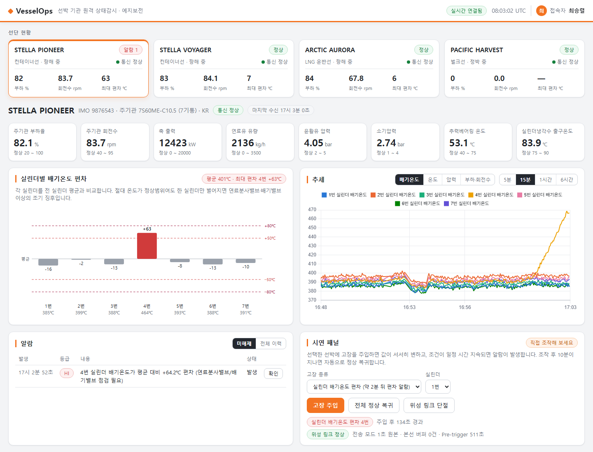

# VesselOps 화면설계서

| 항목 | 내용 |
|---|---|
| 문서명 | 선박 기관 원격 상태감시 플랫폼 화면설계서 |
| 버전 | v1.1 |
| 작성일 | 2026-10-12 |
| 작성자 | 최승렬 |
| 선행문서 | `01-requirements.md` (v1.3), `06-function-spec.md` (v1.0) |

---

## 목차

1. [화면 구성](#1-화면-구성)
2. [영역별 정의](#2-영역별-정의)
3. [색과 상태 표시 규칙](#3-색과-상태-표시-규칙)
4. [시연 시나리오](#4-시연-시나리오)
5. [변경 이력](#5-변경-이력)

---

## 1. 화면 구성

화면은 한 장이다. 위에서 선박을 고르면 아래 전 영역이 그 선박으로 바뀐다.



```
┌──────────────────────────────────────────────────────────────┐
│ VesselOps                     [실시간 연결됨] 08:10 UTC  접속자 │  상단 바
├──────────────────────────────────────────────────────────────┤
│ [STELLA PIONEER] [STELLA VOYAGER] [ARCTIC AURORA] [PACIFIC…]  │  ① 선단 현황
├──────────────────────────────────────────────────────────────┤
│ STELLA PIONEER  IMO 9876543 · 7S60ME-C10.5   [통신 정상]        │  ② 선박 머리글
│ [부하율] [회전수] [축 출력] [연료유량] [윤활유압] [소기압] …      │  ③ 주요 계측값
├───────────────────────────────┬──────────────────────────────┤
│ ④ 실린더별 배기온도 편차         │ ⑤ 추세                        │
│   평균 기준 위아래 막대          │   배기온도 / 온도 / 압력 / 부하  │
├───────────────────────────────┼──────────────────────────────┤
│ ⑥ 알람                         │ ⑦ 시연 패널                    │
│   미해제 / 전체 이력, [확인]      │   고장 주입, 링크 단절          │
├───────────────────────────────┴──────────────────────────────┤
│ ⑧ MQTT 수신 현황                                               │
│   경로 · 초당 건수 · 메시지 목록(전 선박) │ 메시지 원문           │
├──────────────────────────────────────────────────────────────┤
│ ⑨ 전체 계측값 (장비별)                                          │
└──────────────────────────────────────────────────────────────┘
```

폭이 좁으면 2단 영역이 1단으로 쌓인다.

---

## 2. 영역별 정의

| # | 영역 | 표시 내용 | 조작 | 요구사항 |
|---|---|---|---|---|
| ① | 선단 현황 | 선박별 카드 — 선명, 선종·운항 상태, 통신 상태, 부하·회전수·최대 편차, 미해제 알람 수 | 카드를 누르면 선박 선택 | FR-601 |
| ② | 선박 머리글 | 선명, IMO 번호, 주기관 형식·기통 수, 선급, 통신 상태, 마지막 수신 시각 | — | FR-602 |
| ③ | 주요 계측값 | 8개 항목의 현재값·단위·정상범위. 범위를 벗어나면 테두리와 값이 붉어진다 | — | FR-602 |
| ④ | **실린더 편차** | 평균을 기준선으로 한 실린더별 편차 막대, 알람 기준선(HI·HIHI), 실린더별 절대 온도 | 막대에 올리면 상세 값 | **FR-302, FR-403** |
| ⑤ | 추세 | 선택한 묶음의 시계열. 기간 5분 / 15분 / 1시간 / 6시간 | 묶음·기간 전환 | FR-603, FR-605 |
| ⑥ | 알람 | 발생 시각, 등급, 내용, 상태 | 미해제 / 전체 전환, [확인] | FR-604, FR-305 |
| ⑦ | 시연 패널 | 주입된 고장, 위성 링크 상태, 전송 모드, 본선 버퍼 건수 | 고장 주입, 전체 정상 복귀, 링크 단절·복구 | 시연용 (IF-06) |
| ⑧ | **MQTT 수신 현황** | 데이터 경로, 브로커 접속 방식(TLS 버전·인증서), 초당 메시지·계측값, 누적 수신·적재·중복·거부, 받은 메시지 목록(수신 시각·선박·토픽·구분·값 수·순번·지연·크기·처리 결과), 메시지 원문 | 일시정지, 행을 눌러 원문 고정 | FR-155 (IF-04 6.4) |
| ⑨ | 전체 계측값 | 장비별 전 계측점의 현재값 | — | FR-602 |

상단 바의 접속자 이름은 고정 표시다. 로그인(FR-501)은 아직 구현하지 않았다.

### 2.2 MQTT 수신 현황을 둔 이유

| 선택 | 이유 |
|---|---|
| 계측값 화면과 별도로 **메시지 단위**를 보여준다 | 위 영역은 가공된 결과다. 본선에서 실제로 무엇이 어떤 크기·간격으로 오는지는 메시지를 봐야 안다 |
| 선택한 선박이 아니라 **전 선박** | 수집 구간이 살아 있는지를 보는 영역이라 선박을 가리지 않는다 |
| 지연(발행→수신)과 크기를 행마다 | 위성 구간에서 따지는 값이 이 둘이다 |
| 원문은 값 3건까지만 | 화면은 형식을 보여주면 된다. 전량은 DB 에 있다 |
| 접속 방식을 수집기가 맺은 접속에서 읽어 표시 | 설정값이 아니라 실제 협상된 TLS 버전을 보여준다 |

### 2.1 실린더 편차 차트를 이렇게 그린 이유

| 선택 | 이유 |
|---|---|
| 절대 온도가 아니라 **평균 대비 편차**를 막대로 | 절대 온도 막대는 부하가 바뀌면 전 실린더가 함께 움직여, 정작 봐야 할 "한 실린더만 벌어진 것"이 묻힌다 |
| 기준선을 차트 위에 점선으로 | 알람이 나기 전에 "얼마나 남았는지"를 본다. 값은 DB 의 룰에서 가져온다 |
| 위아래 양방향 | 온도가 낮게 벌어지는 것(실화)도 이상이다 |
| 절대 온도는 축 아래 숫자로 | 편차가 주, 절대값이 보조다. 둘 다 필요하지만 무게가 다르다 |

---

## 3. 색과 상태 표시 규칙

바탕은 밝은 회색과 흰색이고, 강조색은 주황이다. **주황은 선택·주 동작에만 쓰고 상태 표시에는 쓰지 않는다.**
강조색과 경보색이 같으면 선택된 카드와 경보 난 카드가 같아 보이기 때문이다.

| 상태 | 색 | 기준 |
|---|---|---|
| 정상 | 녹색 (편차 막대는 회색) | — |
| 주의 | 노랑 | 편차가 알람 기준의 60% 이상. 변화율 알람(WARN) |
| 경보 | 빨강 | HI · LO. 정상범위 이탈 |
| 위험 | 진홍, 색을 채운 표시 | HIHI · LOLO. 통신 단절 |
| 정지 | 회색 | 주기관 정지 중 |

- 편차 차트는 정상 실린더를 회색으로 두고 벗어난 실린더에만 색을 입힌다.
- 추세 차트의 계열색 8종은 이웃한 색이 색각 이상에서도 구분되는 순서로 고정했다.

- 색만으로 구분하지 않는다. 상태는 항상 글자로도 적는다 (예: `알람 1`, `통신 단절`).
- 주기관이 정지한 선박은 값이 범위 밖이어도 붉게 칠하지 않는다. 알람 엔진의 정지 억제와 같은 기준이다.
- 시각은 사용자의 현지시각으로 보여주고, 상단 바에 UTC 를 함께 둔다. 저장과 전송은 전부 UTC 다.

---

## 4. 시연 시나리오

처음 보는 사람이 설명 없이 따라 할 수 있는 순서다. 각각 3분 안에 끝난다.

### 4.1 편차 진단

| 순서 | 조작 | 화면 변화 |
|---|---|---|
| 1 | 항해 중인 선박을 고른다 | 편차 막대가 전부 ±10℃ 안에 있다 |
| 2 | 시연 패널에서 [실린더 배기온도 편차], 실린더를 고르고 [고장 주입] | 해당 실린더 막대가 서서히 올라간다 |
| 3 | 약 1분 뒤 | 막대가 노랑(주의)으로 바뀐다. 편차 30℃ |
| 4 | 약 2분 뒤 | 막대가 주황선을 넘고, 30초 지속 후 알람이 뜬다. 선단 카드에 `알람 1` |
| 5 | [전체 정상 복귀] | 막대가 내려가고 10초 뒤 알람이 해제된다 |

이때 해당 실린더의 **절대 온도는 정상범위(280~430℃) 안에 있을 수 있다.** 임계값 감시만으로는 잡히지 않는 이상이다.

### 4.2 통신 단절과 복구

| 순서 | 조작 | 화면 변화 |
|---|---|---|
| 1 | [위성 링크 단절] | 수 초 뒤 선단 카드가 `통신 단절` 로 바뀐다. 시연 패널의 본선 버퍼 건수가 늘어난다 |
| 2 | 30초쯤 기다린다 | 추세 차트가 그 구간에서 멈춘다 |
| 3 | [위성 링크 복구] | 버퍼 건수가 0 으로 줄고, **추세의 빈 구간이 소급해 채워진다** |

---

## 5. 변경 이력

| 버전 | 일자 | 내용 |
|---|---|---|
| v1.0 | 2026-10-10 | 최초 작성. 구현된 화면 기준으로 영역 정의와 시연 시나리오 정리 |
| v1.1 | 2026-10-12 | 밝은 테마(주황·회색·흰색)로 변경하고 상태색 재정의(3장). MQTT 수신 현황 영역 추가(⑧, 2.2). 상단 바에 접속자 표시 |
